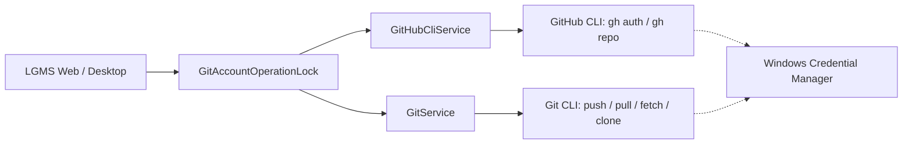

# 🚀 LGMS — Local Git Management System (.NET 9)

**LGMS (Local Git Management System)** is a comprehensive, local-first Git management suite designed for developers who want a fast, secure, and modern interface for managing multiple Git repositories and multiple authenticated GitHub accounts.

It offers two frontend experiences built on a shared, high-performance .NET 9 Core engine with **Microsoft SQL Server (`LGMS_DB`)** and **GitHub CLI (`gh`)** integration:
1. 🖥️ **LGMS Desktop**: A high-performance, native **WPF Desktop Application** (.NET 9) with Dark & Light themes, interactive diff viewer, staging manager, multi-account GitHub browser, remote clone workflows, and integrated sandboxed terminal.
2. 🌐 **LGMS Web**: An **ASP.NET Core MVC 9 Web Application** with Razor views, multi-account GitHub dashboard, remote repository catalog with 1-click clone, and operation audit logging.

---

## 📑 Table of Contents

- [1. System Requirements](#1-system-requirements)
- [2. Solution Architecture](#2-solution-architecture)
- [3. GitHub Multi-Account Integration](#3-github-multi-account-integration)
- [4. Database Architecture (Microsoft SQL Server)](#4-database-architecture-microsoft-sql-server)
- [5. Complete Installation & Setup Guide](#5-complete-installation--setup-guide)
- [6. How to Run the Applications](#6-how-to-run-the-applications)
- [7. Feature Workflow Walkthrough](#7-feature-workflow-walkthrough)
  - [GitHub Multi-Account Management](#1-github-multi-account-management)
  - [Remote Repositories & 1-Click Clone](#2-remote-repositories--1-click-clone)
  - [Workspace Scanning & Discovery](#3-workspace-scanning--discovery)
  - [Working Tree & Staging Manager](#4-working-tree--staging-manager)
  - [Syntax-Highlighted Diff Viewer](#5-syntax-highlighted-diff-viewer)
  - [Commit & Push Flow](#6-commit--push-flow)
  - [Branch & Remote Management](#7-branch--remote-management)
  - [Safe Git Console](#8-safe-git-console)
- [8. Building Desktop Single-File Executables](#8-building-desktop-single-file-executables)
- [9. Project File Structure](#9-project-file-structure)
- [10. Troubleshooting & FAQ](#10-troubleshooting--faq)

---

## 1. System Requirements

| Requirement | Minimum Version | Recommended Version |
| :--- | :--- | :--- |
| **Operating System** | Windows 10 (1809+) or Windows 11 | Windows 11 (x64) |
| **.NET SDK** | .NET 9.0 SDK (`9.0.100`+) | .NET 9.0.305+ |
| **Git for Windows** | Git 2.25+ | Git 2.47+ (in system `PATH`) |
| **GitHub CLI (`gh`)** | GitHub CLI 2.40+ | GitHub CLI 2.100+ (in system `PATH`) |
| **Database Engine** | MS SQL Server 2016+ / LocalDB / Express | MS SQL Server (Default Instance / `SQLEXPRESS`) |
| **Memory (RAM)** | 2 GB | 4 GB+ |

---

## 2. Solution Architecture

The solution ([`LGMS.sln`](file:///e:/Asp.NET%20Work/Test%20Project/LGMS/LGMS.sln)) is cleanly modularized into 3 dedicated projects:

```text
LGMS.sln
│
├── 🧠 LGMS.Core/         → Shared Core Class Library (.NET 9)
│   ├── Data/             → LgmsDbContext (EF Core SQL Server)
│   ├── Migrations/       → EF Core Migrations for MS SQL Server
│   ├── Models/           → GitHubAccount, LocalRepository, GitOperationLog, GitStatus, GitCommit
│   └── Services/         → GitHubCliService, GitAccountOperationLock, ProcessRunner, GitService
│
├── 🖥️ LGMS.Desktop/      → Native WPF Desktop App (.NET 9 Windows)
│   ├── Themes/           → DarkTheme.xaml, LightTheme.xaml, Icons.xaml
│   ├── ViewModels/       → MainViewModel, GitItemViewModel (MVVM)
│   ├── Services/         → SettingsService (persists to %LOCALAPPDATA%/LGMS)
│   └── Views/            → MainWindow.xaml (8 Tabs including Tab 7: 🐙 GitHub)
│
└── 🌐 LGMS/              → ASP.NET Core MVC 9 Web App
    ├── Controllers/      → GitHubController, GitOperationsController, RepositoryController
    ├── ViewModels/       → GitHubViewModels, DashboardViewModel, ChangesViewModel
    ├── Views/            → Views/GitHub (Index, Repositories), Views/Repositories
    └── wwwroot/          → CSS Themes & Vanilla JavaScript
```

### 🔒 Security & Performance Principles:
- **Zero Access Token Storage**: Sensitive access tokens are never saved to SQLite or SQL Server tables. Credential management is delegated to GitHub CLI (`gh`) and the Windows Credential Manager.
- **Serialized Account Execution**: Since GitHub CLI shares active account state globally, `GitAccountOperationLock` guarantees that account-switching and subsequent Git push/pull/clone operations run atomically without race conditions.
- **Commit Identity Separation**: Switching GitHub transport accounts will not alter existing or future commit author identities (`user.name` / `user.email`).
- **Safe Process Invocation**: All process commands use `ProcessStartInfo.ArgumentList` with explicit timeout handling and process-tree termination.

---

## 3. GitHub Multi-Account Integration

LGMS leverages a hybrid engine combining Git CLI for local repositories and GitHub CLI (`gh`) for remote identity and discovery:



1. **Account Discovery**: Automatically reads authenticated accounts from `gh auth status --json hosts`.
2. **Account Switching**: Seamlessly toggles the active account via `gh auth switch`.
3. **Repository Discovery**: Lists accessible public/private repositories with owners, visibility tags, and default branch indicators.
4. **Git Credential Helper**: One-click setup via `gh auth setup-git` to let Git transparently authenticate HTTPS repositories.

---

## 4. Database Architecture (Microsoft SQL Server)

The application uses **Microsoft SQL Server** (`LGMS_DB`) via Entity Framework Core 9.

### Connection String ([`appsettings.json`](file:///e:/Asp.NET%20Work/Test%20Project/LGMS/appsettings.json))
```json
{
  "ConnectionStrings": {
    "Lgms": "Server=.;Database=LGMS_DB;Trusted_Connection=True;MultipleActiveResultSets=true;TrustServerCertificate=True;"
  }
}
```

### Database Tables:
- **`[GitHubAccounts]`**: Stores account metadata (`Id`, `Host`, `Username`, `IsActive`, `LastVerifiedAt`). Unique index on `([Host], [Username])`.
- **`[LocalRepositories]`**: Stores tracked local repository folders (`Id`, `Name`, `LocalPath`, `CurrentBranch`, `LastScannedAt`). Unique index on `([LocalPath])`.
- **`[GitOperationLogs]`**: Audit log of remote operations (`Id`, `RepositoryId`, `Operation`, `Status`, `Message`, `CreatedAt`). Indexed on `([CreatedAt])`.

---

## 5. Complete Installation & Setup Guide

### Step 1: Verify Prerequisites
Open PowerShell and verify:
```powershell
dotnet --version
git --version
gh --version
```

### Step 2: Authenticate GitHub Accounts (CLI)
Authenticate your personal or work accounts via browser login:
```powershell
gh auth login --hostname github.com --web
gh auth setup-git
```

### Step 3: Restore and Build
```powershell
dotnet restore LGMS.sln
dotnet build LGMS.sln
```

### Step 4: Apply Database Migrations (Optional / Auto-run on startup)
```powershell
dotnet ef database update --project LGMS.Core --startup-project LGMS
```

---

## 6. How to Run the Applications

### Running the Web Application (ASP.NET Core MVC 9)
```powershell
cd "e:\Asp.NET Work\Test Project\LGMS"
dotnet run --project LGMS.csproj
```
Open your browser at `https://localhost:5001` or `http://localhost:5000`.

### Running the Desktop Application (WPF Native .NET 9)
```powershell
dotnet run --project LGMS.Desktop/LGMS.Desktop.csproj
```

---

## 7. Feature Workflow Walkthrough

### 1. GitHub Multi-Account Management
- **Web**: Navigate to **GitHub Accounts** from the sidebar. View all authenticated accounts, see who is active, switch active accounts in one click, and check recent operation logs.
- **Desktop**: Click on the **🐙 GitHub** tab. Select any account from the left pane to view its repositories or set it as active.

### 2. Remote Repositories & 1-Click Clone
- Browse remote repositories for any connected account.
- Filter repositories by name or owner in real-time.
- Click **Clone** to launch the clone workflow directly into your workspace.

### 3. Workspace Scanning & Discovery
- Fast scanning of nested directory structures to discover existing Git repositories.
- Displays branch names, clean/dirty indicators, and ahead/behind commit counters.

### 4. Working Tree & Staging Manager
- Stage or unstage individual files or entire change sets.
- Selective discard of working tree modifications.

### 5. Syntax-Highlighted Diff Viewer
- Unified diff viewer with addition, deletion, and hunk indicators.

### 6. Commit & Push Flow
- Structured commit creation with subject, multiline description, and combined **Commit & Push**.

### 7. Branch & Remote Management
- Create, checkout, merge, and delete local and tracking branches.
- Inspect and configure remote URLs (`fetch` and `push`).

### 8. Safe Git Console
- Interactive embedded terminal strictly sandboxed to Git operations.

---

## 8. Building Desktop Single-File Executables

To build an optimized, standalone executable for the Desktop application:

```powershell
dotnet publish "LGMS.Desktop/LGMS.Desktop.csproj" -c Release -r win-x64 --self-contained true -p:PublishSingleFile=true -p:IncludeNativeLibrariesForSelfExtract=true -o "./publish/desktop-standalone"
```

The output executable will be created at `./publish/desktop-standalone/LGMS.Desktop.exe`.

---

## 9. Project File Structure

```text
LGMS/
├── Controllers/
│   ├── GitHubController.cs
│   ├── GitOperationsController.cs
│   ├── RepositoryController.cs
│   ├── HomeController.cs
│   └── SettingsController.cs
├── ViewModels/
│   ├── GitHubViewModels.cs
│   └── ViewModels.cs
├── Views/
│   ├── GitHub/
│   │   ├── Index.cshtml
│   │   └── Repositories.cshtml
│   ├── Repository/
│   └── Shared/
│       ├── _Sidebar.cshtml
│       └── _TopBar.cshtml
├── LGMS.Core/
│   ├── Data/
│   │   └── LgmsDbContext.cs
│   ├── Migrations/
│   ├── Models/
│   │   ├── GitHubAccount.cs
│   │   ├── LocalRepository.cs
│   │   └── GitOperationLog.cs
│   └── Services/
│       ├── GitHubCliService.cs
│       ├── GitAccountOperationLock.cs
│       ├── ProcessRunner.cs
│       └── GitService.cs
└── LGMS.Desktop/
    ├── MainWindow.xaml
    ├── MainWindow.xaml.cs
    ├── App.xaml
    ├── ViewModels/
    │   └── MainViewModel.cs
    └── Common/
```

---

## 10. Troubleshooting & FAQ

#### Q: How do I connect a new GitHub account?
Run `gh auth login --hostname github.com --web` in PowerShell, finish the browser login, and click **Refresh Accounts** in either LGMS Web or Desktop.

#### Q: Does switching accounts change my commit author?
No. Git commit author identity (`user.name` / `user.email`) is kept separate from GitHub authentication credentials.

#### Q: How is database concurrency handled with MS SQL Server?
LGMS uses Entity Framework Core with snapshot isolation and transaction-level exclusive locks during migrations and operations.
